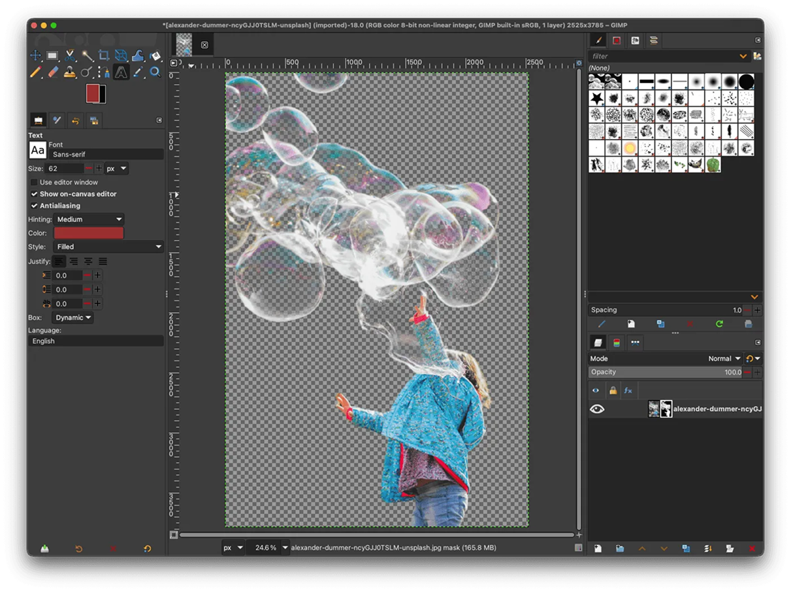
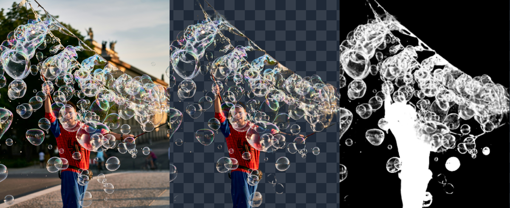
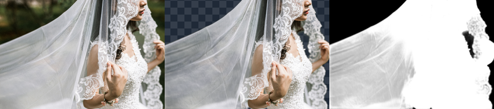

# WithoutBG — GIMP Plugin



**Remove backgrounds in GIMP 3. Private and on-device — nothing leaves your machine.**

A GIMP 3.x plugin that talks to your local WithoutBG server (Mac Local API or Docker). The plugin adds an unapplied layer mask so you can review and refine before committing, and Smart brush fixes the mask from a few strokes.

**[Plugin page →](https://withoutbg.com/open-model/plugins/gimp?utm_source=github&utm_medium=readme&utm_campaign=open-weights-v4&utm_content=withoutbg-gimp-open-model-plugins-gimp)** · **[Local API docs →](https://withoutbg.com/docs/open-model/local-api?utm_source=github&utm_medium=readme&utm_campaign=open-weights-v4&utm_content=withoutbg-gimp-docs-open-model-local-api)**

## See the results





**[Open Weights results →](https://withoutbg.com/open-model/results?utm_source=github&utm_medium=readme&utm_campaign=open-weights-v4&utm_content=withoutbg-gimp-open-model-results)** · **[Cloud API results →](https://withoutbg.com/pro-model/results?utm_source=github&utm_medium=readme&utm_campaign=open-weights-v4&utm_content=withoutbg-gimp-pro-model-results)** · **[Compare →](https://withoutbg.com/compare/withoutbg-open-model-vs-pro-model?utm_source=github&utm_medium=readme&utm_campaign=open-weights-v4&utm_content=withoutbg-gimp-compare-withoutbg-open-model-vs-pro-model)**

## Requirements

| Dependency | Notes |
|---|---|
| GIMP 3.x | Available at [gimp.org](https://www.gimp.org) |
| WithoutBG server | Must be running at `http://127.0.0.1:8000` — [Docker](https://withoutbg.com/docs/open-model/docker?utm_source=github&utm_medium=readme&utm_campaign=open-weights-v4&utm_content=withoutbg-gimp-docs-open-model-docker) `service-cpu` / `service-gpu`, or the [Mac app](https://withoutbg.com/mac?utm_source=github&utm_medium=readme&utm_campaign=open-weights-v4&utm_content=withoutbg-gimp-mac) Local API (or change `SERVER_URL` in `withoutbg/withoutbg.py`). See [Local API docs](https://withoutbg.com/docs/open-model/local-api?utm_source=github&utm_medium=readme&utm_campaign=open-weights-v4&utm_content=withoutbg-gimp-docs-open-model-local-api). |

### Start a server

**Docker (CPU or GPU, any platform):**

```bash
docker run --rm -p 8000:8000 withoutbg/withoutbg-openweights-v4-service-cpu:latest
```

More options: [Docker docs](https://withoutbg.com/docs/open-model/docker?utm_source=github&utm_medium=readme&utm_campaign=open-weights-v4&utm_content=withoutbg-gimp-docs-open-model-docker).

**Mac app:** [download](https://withoutbg.com/mac?utm_source=github&utm_medium=readme&utm_campaign=open-weights-v4&utm_content=withoutbg-gimp-mac), then start the Local API from the menu bar (defaults to port 8000). For CI/automation, see [Mac headless](https://withoutbg.com/mac/headless?utm_source=github&utm_medium=readme&utm_campaign=open-weights-v4&utm_content=withoutbg-gimp-mac-headless).

Run one backend at a time on port 8000.

## Install

```bash
bash -c "$(curl -fsSL https://raw.githubusercontent.com/withoutbg/withoutbg-gimp/main/install.sh)"
```

Or, if you already have the repo:

```bash
./install.sh
```

Then restart GIMP. The plugin appears under:

```
Tools ▸ WithoutBG ▸ Remove Background…
```

## Usage

1. Open any image in GIMP.
2. Go to **Tools ▸ WithoutBG ▸ Remove Background…**
3. The dialog shows the server status and lets you override the server URL.
4. Click **Remove Background**.

The plugin adds an unapplied layer mask from the server’s alpha matte. Review it, then use **Layer ▸ Mask ▸ Apply Layer Mask** to commit.

### Fix the mask with Smart brush

Something went missing, or a bit of background stayed? Paint over it instead of fixing the mask by hand:

1. **Tools ▸ WithoutBG ▸ Smart Brush: Add Paint Layers.** Two layers appear above yours: **withoutBG Keep** (green tag) and **withoutBG Remove** (red tag).
2. Paint on them with any brush at full opacity: on Keep, what went missing; on Remove, what should go. One stroke on an object is enough.
3. **Tools ▸ WithoutBG ▸ Smart Brush: Apply.** The layer mask updates in place (one undo step) and the paint layers are cleared for the next round.

Repeat 2–3 as often as you like. Hand edits to the mask are kept: Smart brush starts from the mask as it is. After the first Apply, later ones on the same layer are much faster: the server runs only the Smart brush model, not the full pipeline (the plugin keeps a small edit context on the layer, saved with XCF files).

Smart brush runs on the local open-weights server (Docker or the Mac app, v4). On a cutout made with withoutBG Pro it runs on Pro instead: each Apply sends the photo and every stroke so far (stateless, 1 credit per Apply), so paint stays on the layers until the cutout is replaced. Pro Smart brush needs `WITHOUTBG_API_KEY` in the environment. Like Remove Background, it works at up to 1024 px and the mask is scaled back to the layer size.

## Configuration

The default server URL (`http://127.0.0.1:8000`) is hardcoded at the top of
`withoutbg/withoutbg.py`. You can also change it per-session inside the
interactive dialog — GIMP remembers the last-used value between runs.

### Optional: withoutBG Pro

No server running, or you want the hosted model? Tick **Use withoutBG Pro (cloud)** in the dialog and paste an API key, or set `WITHOUTBG_API_KEY` in the environment GIMP starts from. With Pro on, the layer (downscaled to 1024 px) is sent to api.withoutbg.com and uses 1 credit. The matte still comes back as an unapplied layer mask. GIMP stores the last-used dialog values, the key included, in your GIMP profile. Use the environment variable if you'd rather keep it out of there. Keys: [withoutBG Pro](https://withoutbg.com/pro-model-api?utm_source=github&utm_medium=readme&utm_campaign=open-weights-v4&utm_content=withoutbg-gimp-pro-model-api).

## Uninstall

```bash
rm -rf ~/Library/Application\ Support/GIMP/3.*/plug-ins/withoutbg   # macOS
# or
rm -rf ~/.config/GIMP/3.*/plug-ins/withoutbg                        # Linux
```

## More than GIMP

This plugin is the **GIMP 3** path: mask-first cutouts via a local server. Same open-weights technology powers the rest of the ecosystem:

| Surface | Choose when |
|---|---|
| **[Mac app](https://withoutbg.com/mac?utm_source=github&utm_medium=readme&utm_campaign=open-weights-v4&utm_content=withoutbg-gimp-mac)** | You want a native desktop cutout tool, with an optional Local API for this plugin |
| **[Docker / self-host](https://github.com/withoutbg/withoutbg-inference)** | You want an HTTP API or browser UI on your own server (CPU or NVIDIA GPU) |
| **[Python package](https://github.com/withoutbg/withoutbg-python)** | You want to embed withoutBG in scripts, notebooks, or backends |
| **[Hugging Face](https://huggingface.co/withoutbg/withoutbg-openweights-onnx)** · **[Space](https://huggingface.co/spaces/withoutbg/withoutbg)** | You want to try a demo or download the ONNX weights directly |
| **[Cloud API](https://withoutbg.com/pro-model?utm_source=github&utm_medium=readme&utm_campaign=open-weights-v4&utm_content=withoutbg-gimp-pro-model)** | You need maximum quality without running inference yourself |

## Model

The withoutBG Open Weights Model (v4, 10.12.4) is a routed bundle: a trained router sends fine strands, soft detail and transparency to the withoutBG matting branch and hard opaque objects, flat scenes and vehicles to BiRefNet. Built with DINOv3.

**Fixing a mask:** v4 servers take Smart brush strokes (`keep_mask` / `remove_mask` / `matte` / `edit_context` on `/v1/remove-background`); the plugin's **Smart Brush** commands use them.

Licensed under the [withoutBG Open Model License](https://withoutbg.com/open-model/license?utm_source=github&utm_medium=readme&utm_campaign=open-weights-v4&utm_content=withoutbg-gimp-open-model-license) (Apache 2.0 for withoutBG portions; Meta DINOv3 License for DINOv3 backbone weights).

## Support

- **Bugs / questions:** [GitHub Issues](https://github.com/withoutbg/withoutbg-gimp/issues)
- **Plugin page:** [withoutbg.com/open-model/plugins/gimp](https://withoutbg.com/open-model/plugins/gimp?utm_source=github&utm_medium=readme&utm_campaign=open-weights-v4&utm_content=withoutbg-gimp-open-model-plugins-gimp)
- **Commercial:** [contact@withoutbg.com](mailto:contact@withoutbg.com)
